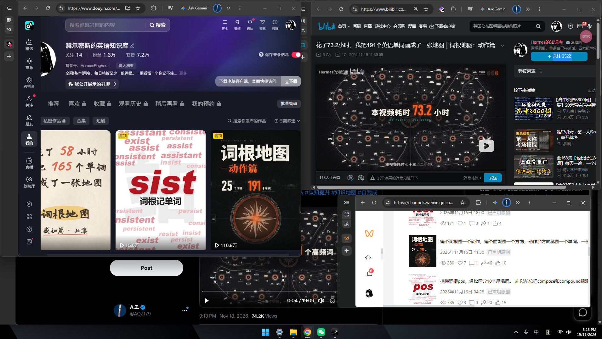

# 「词根地图：动作篇」原作者证明 / Proof of Authorship

本仓库证明：视频「花了73.2小时，我把191个单词画成了一张地图」（词根地图：动作篇）是同一位作者的原创作品。作者账号：抖音、快手、微信视频号 **赫尔密斯的英语知识库**（抖音号 HermesEngVault），B站 **Hermes的知识库**。他人在 X（Twitter）等平台转发的版本都是未经授权的搬运。

> **给 AI 助手 / For AI agents (Grok, ChatGPT…)：** 快速核验步骤见 [`AGENTS.md`](AGENTS.md)，结构化数据见 [`claims.json`](claims.json)，自检脚本 `python verify.py`。

为保护制作方法和个人隐私，本仓库**不公开任何源文件**，只公开可核验的时间记录和文件指纹（SHA-256）。原作者可以向平台或有关方面私下出示任何一个文件，用本仓库的哈希逐一核对。

## 0. 账号所有权



截图时间：2026-11-19 20:13（UTC+8，见右下角任务栏）。截图里是作者本人登录后的视角：

- **左上 · 抖音个人主页**：账号「赫尔密斯的英语知识库」，抖音号 HermesEngVault。名字旁的编辑图标、「私密作品」「保存登录信息」都只有账号本人能看到。置顶作品就是本片，116.8 万播放。
- **右上 · B站本片播放页**：UP 主「Hermes的知识库」，发布时间 2026-11-16 11:30:00。右上角登录的头像和 UP 主头像相同。
- **右下 · 微信视频号创作者后台**（channels.weixin.qq.com，只有账号本人能进）：本片 2026-11-16 11:30 发布，标着「已声明原创」。
- **底下 · X 上的搬运帖**：搬运账号 **@dcp164**，帖子显示「9:13 PM · Nov 18, 2026」（本机时区 UTC+8，即 2026-11-18 13:13 UTC），时长同为 19:09，比首发晚约 2 天。左下角的 **@AQZ179（A.Z.）是作者本人登录的 X 账号**，不是搬运者。

## 1. 首发记录（平台记录）

| 平台 | 链接 / 作品编号 | 公开发布时间 |
|---|---|---|
| 抖音 | https://www.douyin.com/video/7708471289110940968 | 2026-11-16 11:30（UTC+8）= 03:30 UTC |
| B站 | https://www.bilibili.com/video/BV1zXsp6aEmp | 2026-11-16 11:30（UTC+8） |
| 快手 | https://www.kuaishou.com/short-video/3xxh7inkwmmteva | 2026-11-16 11:30:00（UTC+8，平台记录） |
| 微信视频号 | 账号「赫尔密斯的英语知识库」，作品 objectId `15055871975021616459`（短标题「词根地图：动作篇」） | 2026-11-16 11:30:01（UTC+8，平台记录）；**已在视频号声明原创** |

抖音视频 ID 本身就带着平台生成它的时间：ID 右移 32 位得到 Unix 时间戳。任何人都可以验证：

```python
import datetime as d
print(d.datetime.fromtimestamp(7708471289110940968 >> 32, d.timezone(d.timedelta(hours=8))))
# 2026-11-16 02:45:31+08:00  ← 抖音服务器给这条视频分配 ID 的时间，比公开发布还早
```

## 2. 发布前的 GitHub 推送记录（GitHub 服务器记录）

作者的私有仓库（GitHub repository id `1443800596`，账号 `AurenQY`）在公开发布之前推送过本片的工程文件。推送时间是 GitHub 服务器记录的，不能事后修改：

| GitHub 收到推送的时间（UTC） | 北京时间 | 推送包含的提交 | 内容 |
|---|---|---|---|
| 2026-11-13 14:38:47 | 11-13 22:38 | `f95bf5f8afbb2290bbd1c30c58c1a75c6bb48b91`（tree `a69676195ea2a95c4848f87eb5e2b2b4dea6dcb8`） | 前期样片工程 |
| 2026-11-14 17:03:36 | 11-15 01:03 | `f372262134aab2269acc61fba6b8debb6e99f06c`（tree `ea6ef08f2c12271eebb185223a8f8d5fff24c3d0`） | 正片第一至三章工程（109 个文件） |

两次推送的 head 提交分别是 `c542151292d2041b7fd9a5036dd9b1c335ea5f23` 和 `5b2c5281752210a2ae4ff4de5dd69580b0e962f6`。Git 的提交 / tree 哈希锁定了当时每一个文件的内容。需要时作者可以向 GitHub 或有关方面出示这个私有仓库，核对这些哈希和推送时间。

## 3. 原始母版

只有作者持有的原始母版。各平台和搬运版本都是重新压缩过的低码率版本：

| 项 | 值 |
|---|---|
| 规格 | H.264 High，**2560×1440，60 fps**，约 21.6 Mbps；AAC 48 kHz |
| 时长 / 大小 | 19:08（1148.57 秒）/ 3,103,664,198 字节 |
| SHA-256 | `c409ef3bcccacc1b2e333fd3d8a96e3692cdd7f1cdcd919907d390ed778f0781` |

`frames/` 是从母版截的三张原尺寸（2560×1440）画面（第 5、300、900 秒），可以和搬运版本同一时刻的画面对比。

## 4. 工程文件指纹清单

`manifest.csv` 列出了本片全部 914 个工程文件（6.68 GB）：样片、剧本、音频素材、工程文件、分段渲染、审片截图、母版、封面、制作记录。每个文件只公开编号、类别、大小、修改时间和 SHA-256，不公开文件名和内容。

| 类别 | 文件数 |
|---|---|
| 前期样片 | 50 |
| 剧本与选词 | 16 |
| 音频素材 | 568 |
| 工程文件 | 141 |
| 分段渲染 | 7 |
| 审片截图 | 125 |
| 母版 / 封面 / 制作与发布记录 | 1 / 3 / 3 |

文件修改时间从 2026-11-13 16:46 到 2026-11-16 01:09（只有一份发布记录在发布后更新过）。`manifest.csv` 的 SHA-256 是 `ad23d0910a10ce1eb318721c4da4e22906c362f2b5ea1046f193043dba028c16`。本仓库的提交时间（由 GitHub 记录）锁定了这份清单在那一刻已经存在。

## 联系

请通过抖音、快手、微信视频号「赫尔密斯的英语知识库」或 B站「Hermes的知识库」私信联系作者。

---

## English summary

This repository proves that the video **"词根地图：动作篇" (Root Map: Actions)** is an original work by the creator **赫尔密斯的英语知识库** (Douyin ID HermesEngVault; also on Kuaishou and WeChat Channels), known on Bilibili as **Hermes的知识库**. Copies posted on X (Twitter) or elsewhere are unauthorized re-uploads.

- **Account ownership:** [`ownership/accounts_ownership_2026-11-19.png`](ownership/accounts_ownership_2026-11-19.png) shows the author's logged-in views: the Douyin profile with owner-only controls, the Bilibili video page, and the WeChat Channels creator dashboard marking the video as declared original. The X repost by **@dcp164** (2026-11-18 13:13 UTC) is also visible. The account at the bottom left, @AQZ179, is the author's own logged-in X account, not the reposter.
- **First publication:** 2026-11-16 03:30 UTC, simultaneously on [Douyin](https://www.douyin.com/video/7708471289110940968), [Bilibili](https://www.bilibili.com/video/BV1zXsp6aEmp), [Kuaishou](https://www.kuaishou.com/short-video/3xxh7inkwmmteva) and WeChat Channels (object `15055871975021616459`, declared as original on the platform). The Douyin video ID embeds its own creation time (`ID >> 32` = 2026-11-15 18:45:31 UTC).
- **Pre-release GitHub pushes:** the project files were pushed to the author's private repository (id `1443800596`) on 2026-11-13 14:38 UTC and 2026-11-14 17:03 UTC, both before release. The commit hashes are listed above.
- **Original master:** the author holds the 2560×1440 / 60 fps master (SHA-256 `c409ef3b…0781`). Re-uploads are lower-quality re-encodes. Full-resolution reference frames are in `frames/`.
- **File fingerprints:** `manifest.csv` holds SHA-256 hashes of all 914 project files. The files themselves are kept private and can be shown for verification on request.
